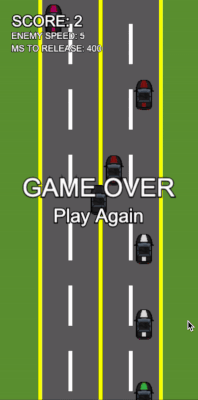

# Pixi Racing Game

Un juego de carreras de ritmo rápido con temática techno oscura construido con PixiJS v5. Esquiva autos enemigos, recolecta power-ups, y sobrevive el mayor tiempo posible mientras la dificultad aumenta progresivamente.



## 🎮 Cómo Jugar

### Controles

**Escritorio:**
- `Flechas` o `WASD` - Mueve tu auto (izquierda/derecha/arriba/abajo)
- `Espacio` - Reiniciar juego (cuando pierdes)
- `M` - Activar/desactivar sonido
- `B` - Mostrar/ocultar panel de debug

**Móvil:**
- `Tocar/Tap` - Mueve tu auto tocando la pantalla

### Objetivo

Evita los autos enemigos que vienen hacia ti el mayor tiempo posible. Mientras más tiempo sobrevivas, más rápido se vuelven los enemigos y con mayor frecuencia aparecen.

## 🎯 Mecánicas de Juego

### Sistema de Puntuación

- **+1 Punto** - Evadir exitosamente un auto (cuando sale de la pantalla)
- **+5 Puntos (Near Miss)** - Pasar a menos de 45 píxeles de un auto enemigo
- **Bonus** - Recolección de power-ups

### Progresión de Dificultad

El juego se vuelve progresivamente más difícil basado en **autos evadidos** (no en puntaje):

**Velocidad de Enemigos:**
- Comienza en: 3 píxeles/frame
- Aumenta en 1 cada 15 autos evadidos
- Máximo: 9 píxeles/frame

**Tasa de Aparición:**
- Retraso inicial: 500ms entre autos
- Disminuye 50ms cada 30 autos evadidos
- Retraso mínimo: 250ms

**Nota:** Los bonos de near miss otorgan puntos extra pero no aceleran la dificultad - solo el conteo real de autos evadidos afecta la dificultad.

## 💫 Power-Ups

Los power-ups se desbloquean después de evadir **10 autos** y tienen un 5% de probabilidad de aparecer por cada auto enemigo.

### Escudo (Hexágono Cian)
- **Duración:** 5 segundos
- **Efecto:** Protege de una colisión
- **Visual:** Burbuja cian semi-transparente alrededor de tu auto
- **Colisión:** El auto enemigo es destruido, tú sobrevives con mensaje "PROTECTED!"

### Cámara Lenta (Reloj Morado)
- **Duración:** 8 segundos
- **Efecto:** Reduce la velocidad de los enemigos al 50%
- **Visual:** Overlay morado en toda la pantalla

### Reglas de Power-Ups
- Solo un power-up puede estar activo a la vez
- Los power-ups no aparecen mientras alguno esté activo
- No puedes recolectar power-ups mientras uno ya está activo
- Todos los power-ups en pantalla se eliminan cuando recolectas uno

## 🎵 Sistema de Audio

### Música de Fondo
- Loop de techno oscuro y rápido con estructura verso/coro
- Cuenta con tres capas: melodía (sawtooth), bajo (sawtooth), y armonía (square wave)
- Verso: Patrón sintetizado repetitivo y oscuro
- Coro: Riff sintetizado con ritmo diferente y onda cuadrada más brillante
- La música se detiene inmediatamente al colisionar y reinicia cuando el juego reinicia

### Efectos de Sonido
- **Colisión:** Retumbo bajo + explosión de crack agudo
- **Recolección de Power-Up:** Campanada positiva (notas C-E-G)
- **Near Miss:** Pitidos de alerta rápidos
- **Golpe de Escudo:** Sonido de deflexión cuando estás protegido
- **Aumento de Puntuación:** Tono rápido por cada auto evadido

Presiona **M** para activar/desactivar el sonido en cualquier momento.

## 🎨 Efectos Visuales

### Vibración de Pantalla
- Se activa al colisionar
- Añade impacto a los momentos de choque

### Efectos de Partículas
- Animación de explosión al colisionar usando sprite sheet de 64 frames

### Popups de Puntuación
- **+1** (verde) - Auto evadido
- **+5** (amarillo) - Bonus de near miss
- **PROTECTED!** (cian) - Protección de escudo activada
- Los popups flotan hacia arriba y se desvanecen

## 🐛 Panel de Debug (Presiona B)

Activa el panel de debug para ver estadísticas del juego en tiempo real:

- **Enemy Speed** - Velocidad actual de los autos enemigos en píxeles/frame
- **MS To Release** - Retraso actual de aparición en milisegundos
- **Cars Evaded** - Número total de autos evadidos (contador de dificultad)
- **FPS** - Frames por segundo actuales
- **Cars to Unlock** - Autos restantes hasta desbloquear power-ups (muestra "N/A" después de desbloquear)
- **Active** - Power-up actualmente activo (Shield/Slow-Mo/None)
- **Time Left** - Tiempo restante del power-up activo en segundos (muestra "N/A" cuando está inactivo)

## 🎮 Configuración del Juego

Todas las constantes del juego están definidas en `scripts/config.js`:

### Pantalla
- Ancho del Juego: 320px
- Alto del Juego: 640px
- Resolución: 2x (para renderizado nítido)
- Carriles: 2

### Dificultad
- Velocidad Inicial de Enemigos: 3
- Velocidad Máxima de Enemigos: 9
- Intervalo de Aumento de Velocidad: Cada 15 autos
- Retraso Inicial de Aparición: 500ms
- Retraso Mínimo de Aparición: 250ms
- Intervalo de Aumento de Tasa de Aparición: Cada 30 autos

### Power-Ups
- Duración del Escudo: 5000ms (5 segundos)
- Probabilidad de Aparición del Escudo: 5%
- Duración de Cámara Lenta: 8000ms (8 segundos)
- Probabilidad de Aparición de Cámara Lenta: 5%
- Multiplicador de Cámara Lenta: 0.5 (50% velocidad)
- Umbral de Inicio de Power-Up: 10 autos evadidos

### Colisión
- Margen de Colisión: 10 píxeles
- Distancia de Near Miss: 45 píxeles

## 🏗️ Arquitectura Técnica

### Estructura de Archivos

```
game/
├── index.html              # Archivo HTML principal
├── scripts/
│   ├── pixi.js            # Librería PixiJS v5.1.6
│   ├── config.js          # Constantes de configuración del juego
│   ├── keyboard.js        # Manejador de entrada de teclado
│   ├── audio.js           # Gestor de Web Audio API
│   ├── car.js             # Clases de auto del jugador y enemigos
│   ├── background.js      # Carretera, carriles y líneas en movimiento
│   └── game.js            # Loop principal del juego y lógica
├── assets/
│   ├── BlackOut.png       # Sprite del auto del jugador
│   ├── RedStrip.png       # Variante de auto enemigo
│   ├── BlueStrip.png      # Variante de auto enemigo
│   ├── GreenStrip.png     # Variante de auto enemigo
│   ├── PinkStrip.png      # Variante de auto enemigo
│   ├── WhiteStrip.png     # Variante de auto enemigo
│   └── explosion/         # Animación de explosión de 64 frames
└── styles/
    └── game.css           # Estilos del juego
```

### Clases Principales

**AudioManager** (`audio.js`)
- Gestiona el contexto de Web Audio API
- Genera efectos de sonido procedurales usando osciladores
- Maneja el loop de música de fondo con timing de precisión de muestra
- Controla nodos de ganancia master, música y SFX

**KeyBoard** (`keyboard.js`)
- Captura eventos de entrada de teclado
- Rastrea estados de teclas (presionada/liberada)

**PlayerCar** (`car.js`)
- Auto controlado por el jugador con movimiento y colisión
- Sistema de animación de explosión

**EnemyCar** (`car.js`)
- Auto enemigo con movimiento automático hacia abajo
- Selección aleatoria de sprite de 5 variantes

**GameBackground** (`background.js`)
- Renderiza carretera, carriles y marcadores de carril
- Anima divisores de carril en movimiento
- Calcula posiciones de carril para aparición

**Game Loop** (`game.js`)
- Gestión principal del estado del juego
- Detección de colisión con margen
- Sistema de detección de near miss
- Aparición y gestión de power-ups
- Lógica de escalado de dificultad
- Seguimiento de puntuación y actualizaciones de UI

## 🚀 Ejecutar Localmente

### Prerrequisitos
- Python 3 instalado en tu sistema
- Navegador web moderno (Chrome, Firefox, Safari, Edge)

### Pasos

1. **Navega al directorio del juego:**
   ```bash
   cd /ruta/a/pixi-racing/game
   ```

2. **Inicia un servidor HTTP local:**
   ```bash
   python3 -m http.server 8000
   ```

3. **Abre tu navegador y visita:**
   ```
   http://localhost:8000
   ```

4. **¡Comienza a jugar!**
   - Haz clic en "START" o presiona Espacio para comenzar
   - Usa las flechas o WASD para esquivar autos
   - Presiona M para silenciar/activar música

### ¿Por qué un Servidor Local?

Los navegadores modernos requieren servidores web para cargar recursos correctamente debido a las políticas CORS (Cross-Origin Resource Sharing). Ejecutar `python3 -m http.server` crea un servidor web local simple que sirve los archivos del juego correctamente.

### Servidores Alternativos

Si prefieres diferentes herramientas:

**Node.js (http-server):**
```bash
npx http-server -p 8000
```

**PHP:**
```bash
php -S localhost:8000
```

**Python 2:**
```bash
python -m SimpleHTTPServer 8000
```

## 🎯 Filosofía de Diseño del Juego

### Dificultad Progresiva
El juego usa un sistema de dificultad dual:
- **Rampa de velocidad** crea desafío momento a momento
- **Aumento de tasa de aparición** añade presión con el tiempo
- La dificultad está ligada a la habilidad (autos evadidos) no a la suerte (near misses)

### Riesgo vs Recompensa
- Los near misses recompensan el juego arriesgado (+5 puntos)
- Los power-ups requieren posicionamiento para recolección
- El escudo fomenta el juego agresivo
- La cámara lenta proporciona respiro estratégico

### Diseño de Audio
- Banda sonora de techno oscuro coincide con el gameplay intenso
- Efectos de sonido generados proceduralmente usando Web Audio API
- No se necesitan archivos de audio - todos los sonidos sintetizados en tiempo real
- Estructura verso/coro añade variedad a sesiones de juego extendidas

## 🛠️ Tecnologías Utilizadas

- **PixiJS v5.1.6** - Motor de renderizado 2D WebGL
- **Web Audio API** - Generación de audio procedural
- **JavaScript Vanilla** - Sin frameworks, puro ES5+
- **CSS3** - Estilos y diseño

## 📝 Licencia

Este es un proyecto personal creado con fines de aprendizaje y entretenimiento.

## 🎮 ¡Diviértete!

¡Intenta superar tu puntuación más alta y ve cuánto tiempo puedes sobrevivir a medida que el juego se vuelve más rápido y más intenso!
